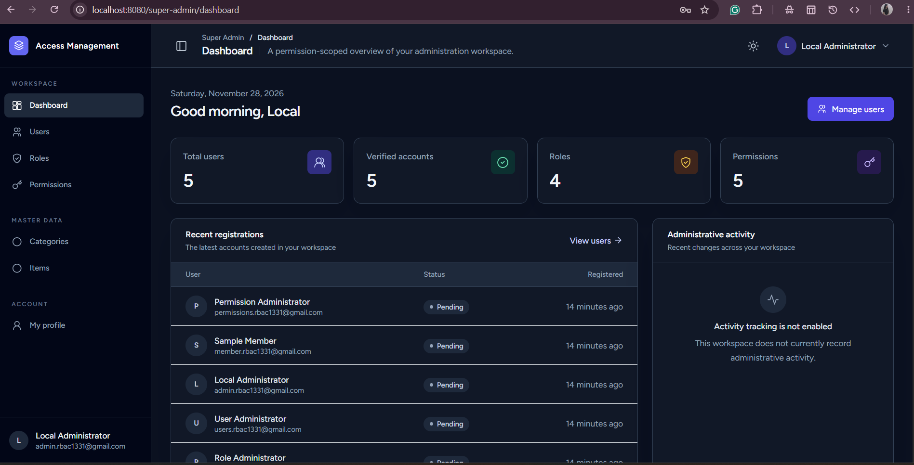

# Laravel User Management & RBAC

A reusable Laravel 11 backend starter featuring session-based authentication, dynamic role-based access control (RBAC), database-backed permissions, policies, and a Service–Repository–Interface architecture.

## Dashboard Preview



## Features

- Session-based web authentication
- User registration, login, logout, and email verification
- Password reset and password confirmation
- Two-factor authentication
- User profile management
- Dynamic role and permission management
- Multiple roles per user
- Multiple permissions per role
- Spatie Laravel Permission v6 integration
- Laravel policies and authorization middleware
- Permission-aware dashboard access
- Service–Repository–Interface architecture
- Reusable CRUD components and Blade layouts
- MySQL and Redis support through Docker
- Docker-based development environment
- Automatic database migrations and local sample seeding on application container startup

## Requirements

### Local Development

- PHP 8.2+
- Composer
- Node.js and npm (for frontend asset development)
- A supported Laravel database (SQLite can be used for local development)

### Docker Environment

- Docker Desktop or Docker Engine
- Docker Compose v2

## Installation

Clone the repository:

```bash
git clone https://github.com/kayzinkhaing/laravel-rbac-starter-.git
cd laravel-rbac-starter-
```

Install PHP dependencies:

```bash
composer install
```

Create your environment file:

```bash
copy .env.example .env
```

Generate the application key:

```bash
php artisan key:generate
```

Configure your database, mail, session, cache, and other environment settings in `.env`.

Run database migrations:

```bash
php artisan migrate
```

Start the application using your preferred local Laravel development environment.

## Docker Setup

The project includes a Docker Compose environment with:

| Component | Technology |
|---|---|
| Application runtime | PHP 8.3-FPM |
| Web server | Nginx |
| Database | MySQL 8.0 |
| Cache / Queue backend | Redis 7 |
| Queue worker | Laravel Queue Worker |
| Scheduler | Laravel Scheduler |
| Frontend assets | Node.js 22 |

### Environment Configuration

Docker Compose reads its configuration values from the project-root `.env`.

The following existing database variables are required:

```env
DB_DATABASE=
DB_USERNAME=
DB_PASSWORD=
DB_ROOT_PASSWORD=
```

Docker-specific variables:

```env
DOCKER_DB_CONNECTION=
DOCKER_DB_HOST=
DOCKER_DB_PORT=

APP_HTTP_PORT=
MYSQL_PUBLISHED_PORT=
```

When running Docker Compose from the `docker` directory, the local `docker/.env` file must be a hard link to the project-root `.env`.

On Windows PowerShell, run this once from the project root if the hard link does not already exist:

```powershell
New-Item -ItemType HardLink -Path .\docker\.env -Target (Resolve-Path .env).Path
```

Keep `.env` out of source control. Do not commit database credentials or other secrets.

### Build and Start Containers

From the project root:

```powershell
Set-Location .\docker
docker compose -p based_code up -d --build
```

Docker Compose starts the application, web server, database, Redis, queue worker, and scheduler.

### Automatic Database Migrations and Seeding

The application container automatically executes:

```bash
php artisan migrate --force
php artisan db:seed --force
```

These commands run before PHP-FPM starts.

Therefore, you do not need to run migrations and seeders manually after starting or rebuilding the application container.

**Important:** The `DatabaseSeeder` only creates sample RBAC data when `APP_ENV` is `local` or `testing`. It does not create sample accounts or sample permissions in production or other environments.

### Persistent Database Storage

Docker uses persistent named volumes:

- `based_code_db_data` — MySQL database storage
- `based_code_redis_data` — Redis data storage

The database data remains available when containers are stopped or recreated, provided the named volumes are not deleted.

Avoid using `docker compose down -v` unless you intentionally want to remove persistent database and Redis data.

### Container Names

| Service | Container |
|---|---|
| Application | `based_code-app` |
| Nginx | `based_code-nginx` |
| Queue Worker | `based_code-queue` |
| Scheduler | `based_code-scheduler` |
| MySQL | `based_code-mysql` |
| Redis | `based_code-redis` |

Check container status:

```bash
docker compose ps
```

View application logs:

```bash
docker compose logs -f app
```

Enter the application container:

```bash
docker compose exec app sh
```

Run an Artisan command manually when needed:

```bash
docker compose exec app php artisan about
```

## Web Authentication

The web guard is the default authentication guard.

The root route renders the public homepage.

After login, registration, email verification, or two-factor verification:

- Ordinary users are redirected to the public homepage.
- Users with the required administrative permission can access the administration dashboard.

Dashboard access requires a verified email address and the `access-admin-dashboard` ability.

Login, registration, logout, email verification, password reset, password confirmation, and profile routes are defined in:

- `routes/web.php`
- `routes/auth.php`

Profile viewing, updating, and deletion are authorized through `UserPolicy` and restricted to the authenticated user's own profile.

## Roles and Permissions

Authorization uses **Spatie Laravel Permission v6**.

Roles and permissions are stored in the database using the `web` guard.

The application supports:

- Multiple roles assigned to a user
- Multiple permissions assigned to a role
- Dynamic role and permission management
- Permission-based dashboard access
- Route-level authorization
- Policy-based authorization
- Blade authorization using `@can`
- Laravel `can` middleware
- Spatie `role`, `permission`, and `role_or_permission` middleware aliases

Users with `manage users`, `manage roles`, or `manage permissions` can access the corresponding administration functionality. Backend authorization protects the management routes.

Permission changes are invalidated through Spatie's permission registrar. The application does not maintain a separate permission cache.

### Role and Permission Security

The application enforces additional authorization rules:

- Administrators cannot assign permissions they do not already possess.
- Administrators cannot edit or delete roles containing permissions outside their authority.
- Only administrators holding all three administrative permissions can change existing administrative permission names.

These checks are enforced by the backend, not just by hiding frontend navigation items.

## Local Sample Accounts

`DatabaseSeeder` creates sample RBAC data only when `APP_ENV` is `local` or `testing`.

Existing users, passwords, roles, permissions, and assignments are left unchanged. Sample permissions and roles are linked only when the seeder creates those roles, and sample roles are assigned only to newly created sample accounts.

All sample accounts use this local-only password:

```text
LocalOnly!2026
```

| Account | Role | Email |
|---|---|---|
| Full administrator | `super-admin` | `admin.rbac1331@gmail.com` |
| User administrator | `user-administrator` | `users.rbac1331@gmail.com` |
| Role administrator | `role-administrator` | `roles.rbac1331@gmail.com` |
| Permission administrator | `permission-administrator` | `permissions.rbac1331@gmail.com` |
| Standard user | None | `member.rbac1331@gmail.com` |

These credentials are strictly for local testing. Change or remove them before using a database outside local development.

Never run local sample seeders against a production database.

## Database Migration Safety

The RBAC migration upgrades the existing `roles` and `permissions` tables in place, adds the `web` guard, copies legacy user-role and role-permission assignments into Spatie's pivot tables, and then removes the obsolete pivot tables.

It does not modify user records.

The legacy domain cleanup migration drops former domain tables and is intentionally irreversible.

**Before applying migrations to an existing installation:**

- Back up the database.
- Review pending migrations.
- Confirm that legacy data is no longer needed before applying irreversible migrations.
- Never run `migrate:fresh` against a database containing data you need to keep.

## Architecture

The application follows a Service–Repository–Interface structure:

| Layer | Responsibility |
|---|---|
| Controllers | Handle HTTP requests, authorization, and responses |
| Services | Contain application use cases and business logic |
| Repositories | Handle data access behind application contracts where appropriate |
| Interfaces | Define application contracts |
| Models | Define Eloquent persistence and relationships |
| Policies | Handle resource ownership and contextual authorization |

This structure helps keep controllers focused and makes business logic easier to maintain and extend.

## Tests

Run the automated test suite:

```bash
php artisan test
```

Feature tests cover:

- Web authentication
- Protected routes
- Role and permission assignment
- Permission inheritance
- Unauthorized access prevention
- Permission-cache invalidation

## License

This project is intended as a reusable Laravel backend starter. Review and configure its security, environment, and deployment settings before using it in a production application.
